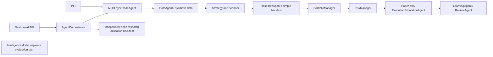

# Trading Project Architecture Baseline

**Review date:** 2026-10-02  
**Scope:** Repository inspection and implementation planning only. No trading business logic was changed for this baseline.

## Current State Summary

The repository is a local Python research and paper-trading prototype for exploring a layered, account-scoped trading workflow. The actual runnable product currently uses deterministic synthetic OHLCV data, simple technical heuristics, a small candidate/backtest filter, basic sizing checks, simulated fills, and JSON records. It is not a live-ready trading system and does not demonstrate profitable or production-safe autonomous account management.

The intended product in the README and architecture notes is broader: a personal-account trading system with specialist agents, risk governance, execution, audit, and learning. Those documents describe desired architecture as well as implemented code; the “institutional-grade” and ORACLE/UAEP labels are framing, not capabilities established by the repository.

There are three overlapping runtime compositions rather than one canonical pipeline:

`MultiLayerTradeAgent` is the direct CLI runner, `IntelligenceModel` builds a separate signal/research/risk/review result, and `AgentOrchestrator` invokes the runner and then independently re-scans, re-researches, reallocates, backtests, and emits fixed team messages. Settings and data are not consistently shared across these paths.

## Implemented Features

- **Python package and CLI entry point:** `pyproject.toml` packages `trade_agent`, requires Python 3.10+, lists pandas/numpy dependencies, and exposes `trade-agent`. The CI workflow installs the package and runs unittest discovery.
- **Configuration contracts:** `AgentConfig` strictly validates mode, booleans, numeric settings, account identity, and credential variable names. `EnvironmentPolicy` and the CLI consume this parser; `ProductionPolicy` applies per-action live checks. Dashboard settings remain separate and live workflows are rejected.
- **Market-data interfaces:** `MarketDataProvider` generates deterministic synthetic OHLCV; `CSVMarketDataProvider` reads a bundled CSV and generates a sample file if missing. Source-aware provider interfaces validate source names.
- **Candidate and signal logic:** `TechnicalSignalGenerator`, `ResearchStrategyEngine`, `AlphaAgentRegistry`, `RegimeDetector`, `MarketScanner`, `AdvisorFilter`, and `ResearchAgent` produce heuristic signals, rankings, regime labels, and backtest-derived candidate reports.
- **Portfolio and risk calculations:** `PortfolioManager` provides single- and multi-symbol allocation structures. `RiskManager` applies a confidence floor and position-size cap. These are simple proposal checks, not account-state risk controls.
- **Backtest and paper simulation:** `Backtester` applies fee/slippage assumptions and reports return, drawdown, win rate, profit factor, costs, and a `paper_ready` flag. `SimulatedBroker` and `ExecutionSimulationAgent` produce local simulated fills; the latter requires an allowed paper policy result and approved risk result and refuses live mode.
- **Broker contracts:** `PaperBrokerAdapter` is local-only. `AlpacaPaperBrokerAdapter` can call the Alpaca paper HTTP API when used directly. `LiveBrokerAdapter` is a placeholder, not a broker integration.
- **Audit, storage, and review primitives:** `MonitoringService`, `ExecutionService`, `RunStorage`, `AuditReportService`, `LearningJournal`, `ReviewAgent`, and `LearningAgent` provide in-memory or JSON audit/learning records. The latest paper learning layer records simulated status and modeled costs but not realized trade P&L.
- **Agent registry and messages:** `AgentProfile`, `AgentTeam`, `AgentMessage`, and `build_default_team()` define 12 role profiles, parent/child profile creation, and basic in-memory message boundaries.
- **Local dashboard:** a standard-library HTTP server serves static files and JSON endpoints; the frontend exposes run/settings/credential forms and a roster. Much of its portfolio, performance, risk, and execution display is static or fallback content.
- **Tests:** the single `tests/test_trade_agent.py` file exercises many service contracts, deterministic behavior, safety-policy checks, storage, team boundaries, and paper simulation. After the configuration-hardening update, `pytest -q` and `python -m unittest discover -s tests` each passed 64 tests.

## Partial or Prototype Features

| Area | Current behavior | Why it remains prototype-level |
| --- | --- | --- |
| Market data | Synthetic sequence and bundled CSV work locally. | `RealMarketDataProvider` accepts names such as `alpaca`, `polygon`, and `yfinance` but routes each to the CSV-backed implementation. The default scanner uses synthetic data. The synthetic provider seeds the same random sequence for each symbol, so symbols do not represent independent market histories. No freshness, timestamp alignment, corporate-action, market-calendar, or provenance validation is enforced. |
| Strategy and research | Heuristic trend/volatility scores are produced; `ResearchAgent` ranks candidates using backtest metrics. | Confidence is not calibrated. Research uses the same limited history for selection and evaluation; there is no walk-forward or holdout validation, benchmark, universe/survivorship treatment, or statistically defensible evidence threshold. `paper_ready` means only configured minimum trade count, positive return, and a drawdown ceiling. |
| Portfolio and risk | Allocation maps are produced and risk checks return approval/reason/size. | `RiskManager.max_daily_loss` is stored but not evaluated against P&L. Portfolio `risk_budget_used` is confidence-derived and capped in the returned value; exceeding the budget does not itself scale or reject positions. There is no live account/position/order state, correlation, liquidity, leverage, stop, or aggregate loss control. |
| Execution | Local simulator and a guarded `ExecutionService` exist. A paper Alpaca adapter has request methods. | The main runner uses only the simulator; it does not reconcile orders or positions with a broker. The Alpaca paper adapter is not part of the runner and its contract tests override `_request`, so no HTTP integration is verified. There is no partial-fill, cancel/replace, order-state, market-hours, retry, or reconciliation lifecycle. |
| Agent architecture | Profiles, capabilities, message objects, and child-profile registration are present. | Profiles do not instantiate or authorize executable specialists. The orchestrator sends a fixed list of messages after running separate calculations; messages are in memory and are not the controlling data path. The role roster therefore documents a design more than it implements a cooperating agent network. |
| Review and learning | Paper reviews are persisted and candidate adjustments can be returned. | Review feedback is calculated from the current portfolio; historical lessons are not consumed as evidence by subsequent scans. Returned next-cycle ordering is not wired into the next scan. Execution outcome records do not contain realized P&L, exits, or validated causal attribution. |
| Dashboard and API | The local UI can request a payload, change session settings, run the orchestrator, and export JSON. | The API payload has only sparse live data; many UI values are hardcoded, and JavaScript supplies fallback signal values. Settings are not applied to the orchestrator's agent configuration. The displayed account, P&L, risk, and order state is not a trustworthy account ledger. |
| Persistence and operations | JSON files in the system temporary directory hold run history and audit data. | Storage is not transactional, concurrency-safe, access-controlled, or designed for retention/recovery. `LearningJournal` suppresses storage exceptions. There is no operational health/alerting, durable database migration, backup, or restore process. |

## Missing Production Features

1. **One executable contract:** a single configuration source and one canonical pipeline must govern CLI, dashboard, orchestration, policy, risk, and execution. The CLI now explicitly rejects live/backtest modes and unsupported strategies, but dashboard/orchestrator configuration is still not unified with the runner.
2. **Production-quality data:** a selected, licensed provider; real source adapters; freshness and schema checks; symbol metadata; market calendars; adjusted prices; missing/duplicate/out-of-order bar handling; and persisted source/time provenance.
3. **Validated strategy evidence:** deterministic replay, holdout and walk-forward evaluation, realistic entry/exit and position state, benchmark comparisons, parameter/version tracking, sample-size controls, and statistical uncertainty. No return target is evidence of profitability.
4. **Account-state risk controls:** reconciled equity, positions and open orders; exposure and concentration limits; daily realized/unrealized loss; drawdown halts; buying-power and liquidity checks; asset-specific constraints; and a kill switch enforced at every execution boundary.
5. **Order lifecycle:** stable client order IDs, idempotency, durable state transitions, partial fills, cancel/replace, rejection handling, timeout/retry policy, price/quantity precision, market sessions, fees, slippage, and broker reconciliation.
6. **Consistent authorization:** one fail-closed gate covering mode, explicit account identity, credentials, risk approval, human approval, kill-switch state, and audit provenance for every broker route. The gate must be enforced by the executor, not only by a separate policy class or UI state.
7. **Trustworthy learning:** associate each decision with later fills, exits, realized P&L, costs, and market context; preserve immutable evidence; evaluate proposed changes offline; and require new paper validation and approval before changing strategy or risk behavior.
8. **Operational security and service controls:** authenticated and protected dashboard/API, TLS where remotely reachable, secure secret management, request limits and input validation, access/audit policy, monitoring/alerts, backup/recovery, deployment and incident runbooks.
9. **Quality gates:** broader Python-version CI, lint/type checks, dependency/security checks, integration and property tests, frontend/API smoke tests, broker sandbox tests, and deterministic fixtures. Current CI tests only Python 3.10 and unittest discovery.
10. **Product boundaries and documentation:** specify supported instruments, accounts, data sources, trading cadence, decision authority, failure behavior, and what “paper ready” means. Update README and older architecture notes where they imply functionality not currently wired.

## Recommended Implementation Order

1. **Freeze live execution off and reconcile claims with behavior.** Make CLI arguments effective or reject unsupported modes; select a canonical runner; ensure dashboard settings cannot claim or request behavior that the runner ignores. Treat `LiveBrokerAdapter` and `ProductionReadinessGate` as placeholders, not approval to trade.
2. **Harden the paper execution boundary.** Route every execution attempt through a single explicit account/mode/risk/approval contract. Make denied, skipped, duplicate, timed-out, and failed outcomes explicit and auditable. Keep live adapters unavailable during this stage.
3. **Establish a canonical data contract.** Start with one instrument class and one real or explicitly labeled replay source. Validate timestamps, OHLCV values, freshness, symbol identity, gaps, and source provenance; keep deterministic test fixtures separate from production data.
4. **Correct and test risk/portfolio semantics.** Enforce rather than merely report budget limits; connect daily-loss settings to realized state; use actual account exposure and aggregate proposed positions; define invariant tests for sizing, budget, loss, and invalid/non-finite inputs.
5. **Build a credible research harness.** Add point-in-time replay and walk-forward/holdout evaluation with realistic costs and trade lifecycle, then define promotion thresholds. A passing backtest is research evidence, not an execution authorization.
6. **Make paper operation stateful and reviewable.** Persist decisions, approvals, orders, fills, positions, and outcomes in a transactional store; reconcile state on restart; test idempotency and failure recovery. Feed only verified, realized paper outcomes into review, and consume candidate feedback explicitly in the next research cycle.
7. **Make the dashboard truthful and safe.** Render only backend-sourced state; remove hardcoded P&L/order/risk displays; make all mutating endpoints authenticated and unavailable over insecure remote transport; avoid collecting broker secrets in the UI until there is a secure supported secret-management path.
8. **Prove operational readiness.** Add monitoring, alerting, kill-switch exercises, backups, recovery drills, versioned strategy/risk configuration, and CI checks across supported Python versions.
9. **Consider live integration last.** Only after paper evidence, security review, account reconciliation, human approval workflow, and operational gates are proven should a separately scoped live adapter be implemented. Validate against broker sandbox/test contracts; never place real orders during development verification.

## High-Risk Gaps

- **Live execution is intentionally unavailable.** `ProductionPolicy` validates explicit opt-in, matching configured and per-action account IDs, both non-empty credentials, and per-action manual approval. Live audits remain pending until explicit approval; `ExecutionService` is paper-only; `LiveBrokerAdapter` now fails after policy validation because live submission is not implemented. This is safer, but there is no working live broker route. Credential presence cannot establish credential validity without a supported broker validation flow.
- **Risk-budget reporting can conceal over-allocation.** `PortfolioManager.plan_portfolio()` caps the returned budget-used number but does not reduce or reject positions for that cap. `RiskManager` does not use its `max_daily_loss` setting. Results can therefore appear compliant without enforcing those controls.
- **Dashboard exposure can leak control and credentials.** The server can bind to a non-loopback host, serves plain HTTP, and has unauthenticated POST endpoints for settings, workflow runs, and credentials. The credential endpoint puts submitted secrets into the server process environment. The UI copy says secrets are not stored/displayed, but they are held in process memory/environment while the server runs. Do not expose this server to an untrusted network.
- **Dashboard configuration remains disconnected.** Dashboard mode/manual-approval settings update API state but do not reconfigure the orchestrator's runner; live settings are now rejected. `EnvironmentPolicy` and CLI share strict environment parsing, but the application still has multiple pipeline compositions.
- **Dashboard state is not evidence.** Hardcoded sample values and frontend fallback signal values can look like account or performance data while not coming from the trading workflow.
- **Research outputs can be overinterpreted.** Synthetic data is reused across symbols, and backtest results are used to qualify candidates on the same data. Neither is a valid estimate of future live performance.

## Missing Tests and Validation

The tests are useful unit/contract coverage, but they do not establish production readiness. Important additions include:

- End-to-end tests proving each unsupported mode is rejected, paper requests cannot cross into live adapters, policy denial has no execution side effect, and account identity/approval provenance survives the complete route.
- Regression/property tests proving portfolio risk budgets are actually enforced, daily loss halts work, exposure remains bounded under many symbols, and NaN/inf/negative values fail closed.
- Data tests for stale, duplicate, missing, malformed, out-of-order, wrong-symbol, and synthetic-vs-real source behavior.
- Backtest tests for no look-ahead, point-in-time universes, held-position accounting, exits, costs, and independent holdout/walk-forward datasets.
- Broker paper-sandbox contract tests for order lifecycle, partial fills, rejects, retries, duplicate submissions, and reconciliation. Existing Alpaca tests override `_request`; they do not exercise HTTP or a sandbox account.
- Storage restart, corruption, concurrent-write, permissions, retention, and recovery tests.
- Dashboard/API tests for effective settings, authorization, secret handling, host binding, request validation, and truthful rendered values.
- CLI tests proving `--mode`, `--strategy`, symbol, equity, and capital reach the expected implementation.
- CI across the declared Python support range, plus lint/type/dependency-security and frontend smoke checks.

The current suite can pass while important safety contracts are disconnected because most tests exercise components independently. Test-isolation also needs attention: at least one policy test sets credential environment variables without restoring their previous values.

## Recommended MVP Scope vs Full Production Scope

| | Paper MVP | Full production system |
| --- | --- | --- |
| Product boundary | One explicitly configured personal account; one chosen asset class; one validated data source; one versioned strategy; research and paper execution only. | Multiple accounts/asset classes and brokers only where separately justified, supported, reconciled, and tested. |
| Data and research | Real/replay data with timestamp/provenance checks; reproducible replay; walk-forward and holdout reports with conservative costs; no profitability promises. | Licensed feeds, point-in-time corporate/event data, strategy registry and monitored model validation, expanded robustness and stress testing. |
| Risk and execution | Account-state paper positions/orders; enforced exposure, daily loss, drawdown, sizing, kill switch, order lifecycle, idempotency, reconciliation, and durable audit trail. | Redundant controls, broker-specific constraints, operational approvals, failover and disaster recovery, continuous reconciliation, controlled live release gates. |
| Learning and agents | Small set of real, deterministic modules with explicit contracts; reviewers record realized paper outcomes; future-cycle feedback is transparent and non-authoritative. | Broader specialist services only where they add measurable value; governed delegation, versioned models/policies, independent validation, and approval for all behavioral changes. |
| UI and operations | Local authenticated or strictly loopback-only truthful dashboard; run state, data freshness, risk/approval, orders/fills, and health; no secret-entry feature. | Hardened deployment, identity/access controls, secret manager, encrypted transport/storage, alerting, audit retention, runbooks, backups, and incident response. |
| Live execution | Explicitly out of scope. | Separate broker implementation only after paper MVP acceptance, threat/risk review, manual approval and account-bound controls, sandbox certification, and staged operational sign-off. |

**MVP acceptance should mean:** reproducible inputs; correct, fail-closed limits; durable and reconciled paper order/position state; realistic enough costs; explainable decisions; tested recovery and kill switch; and a dashboard that never reports fabricated account outcomes. It must not mean “profitable” or “live ready.”

## Repository Evidence and Verification

Primary code reviewed: `trade_agent/agent.py`, `agents.py`, `config.py`, `data.py`, `strategy.py`, `scanner.py`, `research.py`, `backtest.py`, `portfolio.py`, `risk.py`, `security.py`, `policy.py`, `broker.py`, `execution.py`, `monitoring.py`, `orchestration.py`, `intelligence.py`, `review.py`, `team.py`, `storage.py`, `api.py`, `server.py`, `frontend.py`, `orders.py`, `events.py`, `regime.py`, `alpha.py`, `advisor.py`, `performance.py`, and `report.py`; plus README, package metadata, CI, both architecture/gap-analysis documents, frontend assets, and `tests/test_trade_agent.py`.

Fresh verification run during this review:

- `pytest -q` — 56 passed.
- `python -m unittest discover -s tests` — 56 passed.

Passing tests establish the covered local contracts only; they do not verify external data quality, broker sandbox behavior, account reconciliation, profitability, or live readiness.
